<div align="center">

# DMT-99 Custom Firmware

**A from-scratch firmware for the FNIRSI DMT-99 multimeter, written in Rust,
with a Material 3 interface, a PC simulator and a one-click Linux flasher.**


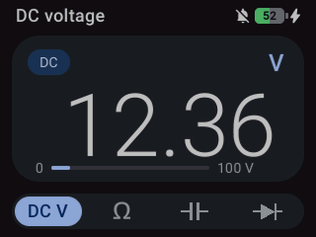&nbsp;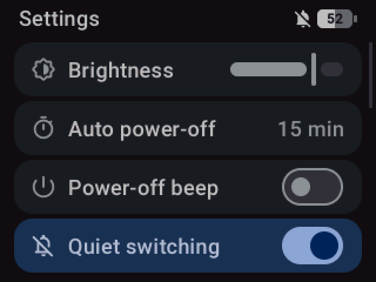

</div>

---

## Highlights

- **Native UI, no image assets.** Everything is drawn in code: anti-aliased rounded shapes,
  Material 3 colours, Google Material Symbols icons and an Android-style battery.
- **Typography done properly.** Roboto glyphs are supersampled and stored in two sub-pixel
  phases, laid out with a 1/16 px pen and the font's kerning, so words keep even spacing on a
  320×240 panel.
- **Fast.** Boots in a fraction of the stock time, because nothing is decoded from flash.
  Only changed screen strips are redrawn while the mode strip animates.
- **Stock-like controls.** Same buttons, same mode groups, plus long presses for DC/AC and REL.
- **Quiet.** Optionally mutes the measurement chip's beep on power-on and on every mode
  change, and can replace its NCV and continuity sounds with the firmware's own, at your volume.
- **Settings that stick**: brightness, auto power-off, sounds, remembered mode, °C/°F and
  language (English / Russian), stored in the meter's settings flash page.
- **Games** in the menu: *Snake* and *Runner* (an endless runner across an oscilloscope
  screen), each with easy / medium / hard levels, and the classic *15 Puzzle*.
- **Pixel-identical simulator.** The UI crate is shared, so what you see on the PC is what
  the meter draws. A fake measurement chip speaks the real wire protocol.
- **Safe to try.** The bootloader is never touched: the stock firmware can always be flashed back.

## Screenshots

| Measurement | | |
|:-:|:-:|:-:|
| 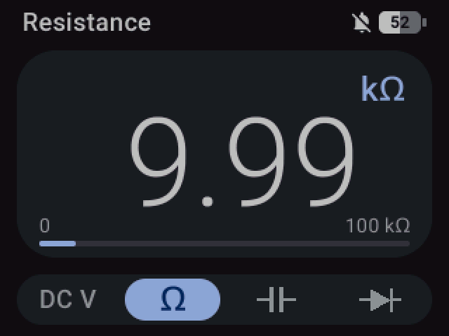 | 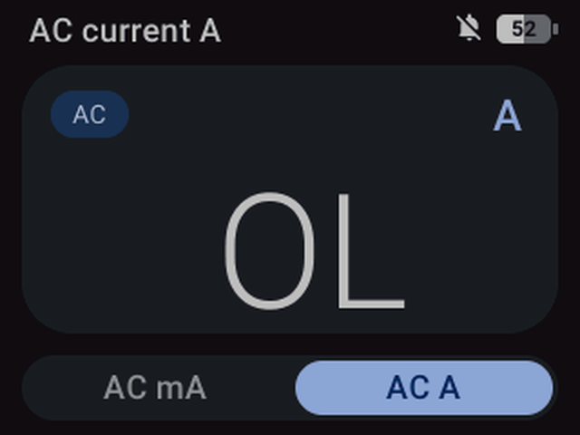 | 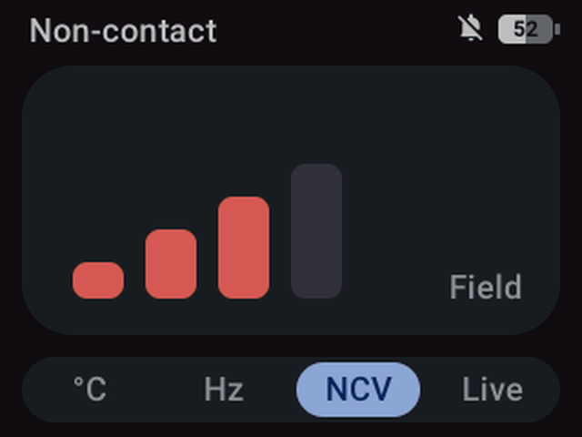 |
| Resistance | AC current, mA | Non-contact voltage |
| 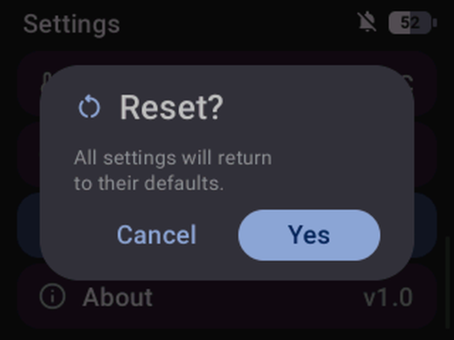 | 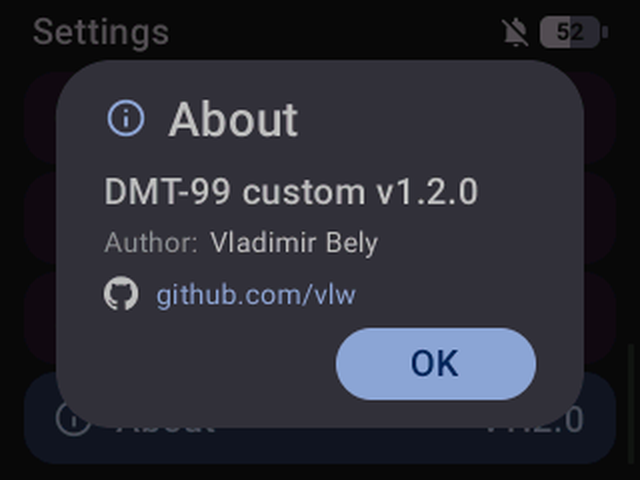 | 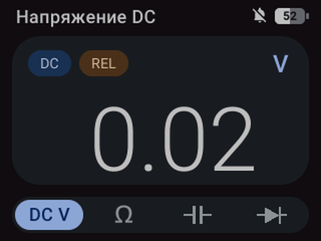 |
| Confirmation dialog | About | Russian UI, REL |
| 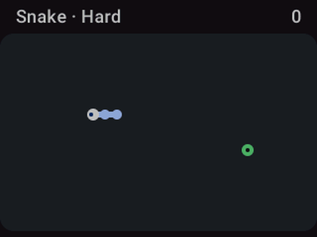 | 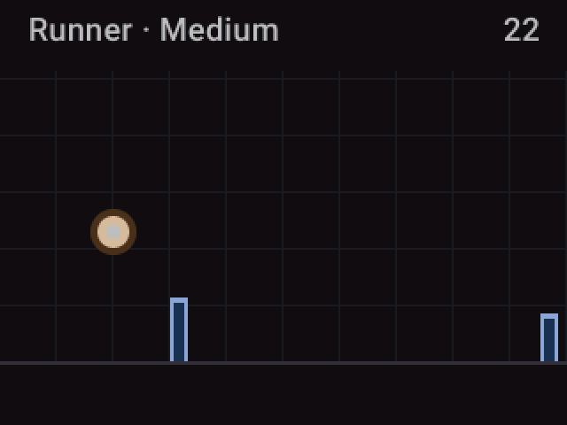 | 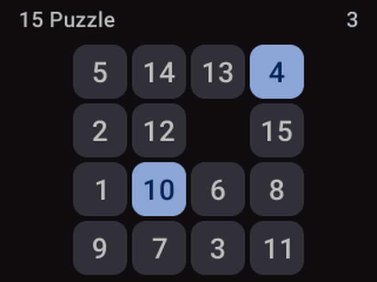 |
| Snake | Runner | 15 Puzzle |

## Controls

| Button | Short press | Hold (0.6 s) |
|---|---|---|
| **▶ Right** | V → Ω → capacitance → continuity | DC ↔ AC voltage |
| **◀ Left** | mA ↔ A | DC ↔ AC current |
| **▼ Down** | °C → Hz → NCV → Live | — |
| **▲ Up** | HOLD | REL (relative zero) |
| **● Centre** | AUTO | Settings / back |
| **Power** | Power off (saves settings) | — |

In the menu ▲/▼ move between rows, ◀/▶ change a value and OK toggles or opens it.
In games the arrows react on press, OK is the action button and holding OK leaves the game.

## Settings

| Setting | Default | |
|---|---|---|
| Brightness | 4 / 5 | Backlight PWM |
| Auto power-off | 15 min | Off / 5 / 15 / 30 min of inactivity |
| Power-off beep | off | |
| Quiet switching | **on** | Mutes the chip's beep at power-on and on mode changes |
| Own NCV sound | off | Firmware beeps by field level instead of the chip |
| Own continuity | off | Firmware tone on short circuit (adds ~170 ms latency) |
| Remember mode | on | Start in the last mode instead of AUTO |
| Volume | 3 / 4 | For the firmware's own sounds |
| Temperature | °C | °C / °F |
| Language | Русский | Русский / English |
| Reset settings | | With a confirmation dialog |
| Games | | Snake and Runner (three difficulty levels), 15 Puzzle; best results per level are kept until power-off |
| About | | Version, author, repository |

## Quick start (Linux)

```bash
./build.sh          # compile → DMT99-custom.BIN
./flash-dmt99.sh    # put it on the meter, then press AUTO on the meter
```

**No toolchain?** Every tagged version is built by GitHub Actions: download
`DMT99-custom-vX.Y.Z.BIN` from the [Releases](../../releases) page and flash it with
`./flash-dmt99.sh DMT99-custom-vX.Y.Z.BIN`.

## Building

### 1. Install the tools (once)

On Debian / Ubuntu:

```bash
sudo apt install llvm python3 libsdl2-dev
curl --proto '=https' --tlsv1.2 -sSf https://sh.rustup.rs | sh    # skip if rustup is installed
```

`llvm` provides `llvm-objcopy`, `libsdl2-dev` is only needed for the simulator. The exact Rust
version and the RISC-V target are pinned in `rust-toolchain.toml`; `./build.sh` installs them
on first use, so local builds are byte-identical to the GitHub releases.

### 2. Build

```bash
./build.sh
```

The script checks the tools above and tells you what to install if something is missing.
It then compiles the firmware, converts it to `DMT99-custom.BIN` and checks that the image
has the layout the stock bootloader expects.

## Flashing from Linux

1. **Put the meter in update mode:** switch it off, hold the **centre (AUTO/MENU)** and
   **power** buttons, then connect USB.
2. **Run the flasher:**

   ```bash
   ./flash-dmt99.sh                 # flashes DMT99-custom.BIN
   ./flash-dmt99.sh other.BIN       # or any other image, e.g. the stock firmware
   ```

   It waits for the meter if you have not connected it yet, asks for your sudo password, saves
   a backup of the meter's update disk to `backups/` and writes the file.
3. **Press AUTO on the meter** when the script says so. The meter installs the firmware in
   about 10 s and restarts.

**Desktop icon (optional):** `./flash-dmt99.sh --install-launcher` adds a *DMT-99 Flash* icon
to your desktop and app menu. Double-click it to flash, or drop a `.BIN` file on it.

> **Why a script?** The bootloader exposes a FAT12 volume with 4096-byte sectors, but its
> partition table counts in 512-byte units. Linux truncates the partition and mounts it
> read-only. `tools/bootdisk.py` reads the disk raw, adds the file the way Windows would
> (8.3 entry, contiguous clusters, both FATs), writes back only the changed blocks and
> verifies them by reading them back.

**On Windows**, copy the `.BIN` to the `BOOT` disk that appears in update mode and press **AUTO**.

**Back to stock:** flash the official `DMT-99_V2.4_20240306.BIN` from FNIRSI the same way.
The bootloader and the measurement chip are never modified.

## Development

### Simulator

```bash
cd sim && cargo run --release
```

Arrows and Enter act as the buttons, Shift + arrow is a long press, Backspace is a long OK.
`+` / `-` change the simulated battery, `C` toggles charging, `Q` quits.
Headless screenshots: `cargo run --release -- --shot out.ppm en,right,uplong`.

### Tests

```bash
cd ui && cargo test
```

The tests cover the protocol parser (with frames captured from a real meter), mode switching,
settings storage, the sound logic, text layout, and a check that every menu label fits next
to its control in both languages.

### Fonts and icons

`ui/src/font_data.rs` is generated and committed, so you only need this after changing
glyphs, sizes or icons. It needs Pillow (`sudo apt install python3-pil`), the
`fonts-roboto-unhinted`, `fonts-noto-core`, `fonts-dejavu-core` and `fonts-font-awesome`
packages, and the Material Symbols font:

```bash
curl -L --create-dirs -o tools/fonts/MaterialSymbolsRounded.ttf "https://github.com/google/material-design-icons/raw/master/variablefont/MaterialSymbolsRounded%5BFILL,GRAD,opsz,wght%5D.ttf"
python3 tools/gen_font.py > ui/src/font_data.rs
```

## Releases

The [build workflow](.github/workflows/build.yml) tests and builds every push. To publish a
version, bump `version` in `ui/Cargo.toml` (the firmware shows it in *About*), commit, then:

```bash
git tag v1.1.0 && git push origin v1.1.0
```

The workflow checks that the tag matches the version and attaches the firmware image and its
SHA-256 to a new release.

## How it works

| Part | Interface |
|---|---|
| MCU | WCH CH32V303RCT6, RISC-V, 144 MHz (8 MHz HSE × 18) |
| Display | 320×240 ST7789-family panel, 16-bit 8080 bus on GPIOB, PC3–PC5/PC13 control |
| Backlight | TIM8 CH1, PC6 |
| Buttons | PC8–PC12, power key PC2, power latch PC1 |
| Buzzer | TIM2 CH2, PA1 (shared with the measurement chip) |
| Battery | ADC1 ch10 on PC0, charge detect on PA8 |
| Measurement chip | USART1 9600 8N1 (PA9/PA10), received through a DMA ring |
| Settings | Flash page `0x08040000`, written with the stock sequence |

- **Measurement.** A dedicated measurement chip does the measuring, ranging and calibration.
  The firmware selects a mode with `AA 55 05 <mode> 00 00 00 00 00 <mode+5>`. The chip
  answers with an event and then streams 12-byte `5A A5 …` frames describing its LCD: digits,
  decimal point, unit and AC/DC. The firmware resends the mode until the chip confirms it,
  because the chip may still be booting.
- **Quiet switching.** The chip drives the shared buzzer by itself. Holding PA1 high while the
  chip would beep keeps the driver saturated, so the chip's tone cannot sound. The firmware
  releases it 250 ms after the chip confirms the new mode.
- **Rendering.** The screen is drawn in 24-row bands into a 15 KB buffer: there is no RAM for
  a full frame. Each band is streamed to the panel.
- **Image layout.** The app links at `0x6400` behind the 25 KB stock bootloader, with the
  same header and vector-table position as the stock image.

## Repository layout

```
ui/                   shared no_std crate: app, screens, games, Material 3 widgets, text, protocol parser
device/               firmware: startup, bare-register drivers (clock, LCD, keys, UART/DMA, flash…)
sim/                  SDL2 simulator with a fake measurement chip
tools/gen_font.py     font and icon rasterizer (generates ui/src/font_data.rs)
tools/bootdisk.py     FAT12 writer for the bootloader disk (Linux)
build.sh              builds DMT99-custom.BIN
flash-dmt99.sh        flasher for Linux (--install-launcher adds a desktop icon)
docs/screenshots/     images for this README
```

## Limitations

- The DMT-99 has no real-time clock, so there is no time or date.
- The continuity/diode mode id (`0x0E`) was inferred from the stock firmware, not documented.
- Measurement accuracy is the measurement chip's own: the firmware only displays its readings.

> **Safety.** This is a hobby project. It does not certify accuracy, calibration or the
> meter's safety rating. Do not rely on it for hazardous measurements.

## Credits

- Hardware and protocol research by [smhgzll/dmt-99-multimeter-custom-firmware](https://github.com/smhgzll/dmt-99-multimeter-custom-firmware)
  (MIT): pin map, LCD init and the measurement-chip frame format, cross-checked here
  against the stock firmware.
- Fonts and icons: Roboto (Apache 2.0), Noto Sans and DejaVu Sans (OFL / free), Material
  Symbols (Apache 2.0), Font Awesome (OFL) for the GitHub mark.
- FNIRSI and DMT-99 are trademarks of their owner. This project is not affiliated with FNIRSI
  and ships none of its firmware.

## License

[MIT](LICENSE) © 2026 Vladimir Bely. Bundled font data keeps its own licenses (see Credits).

## Author

**Vladimir Bely** · [github.com/vlw](https://github.com/vlw)
