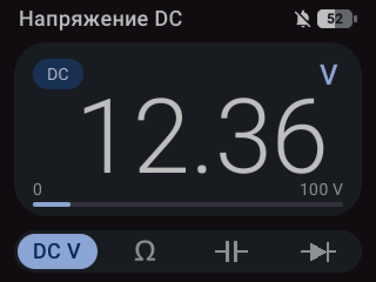
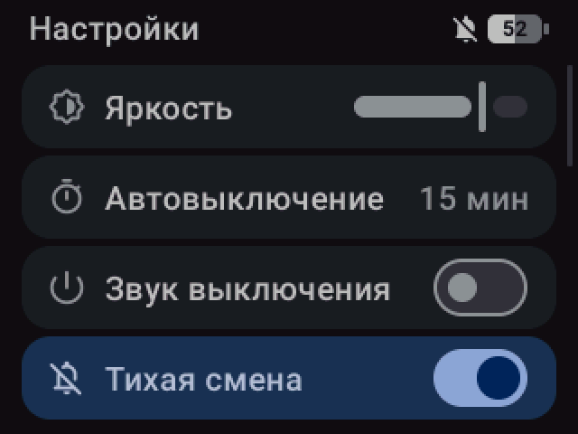
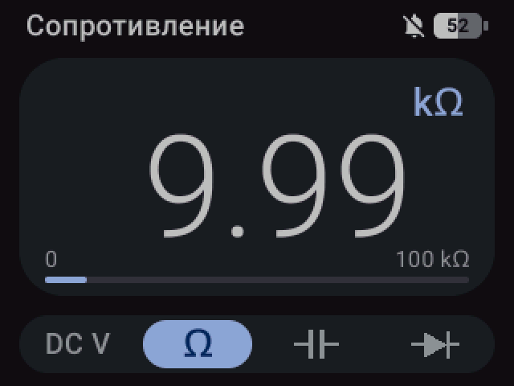
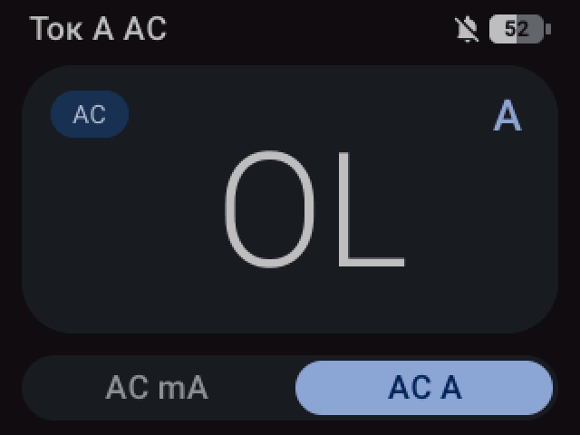
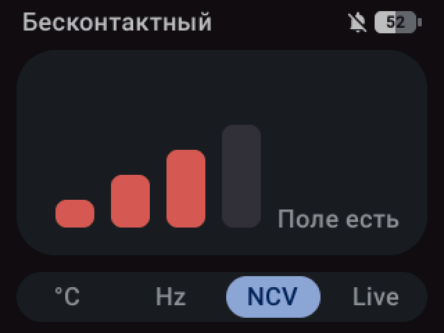
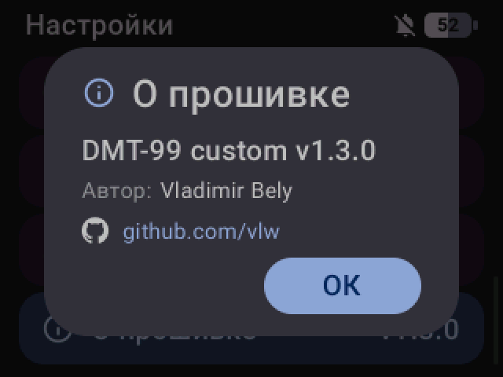
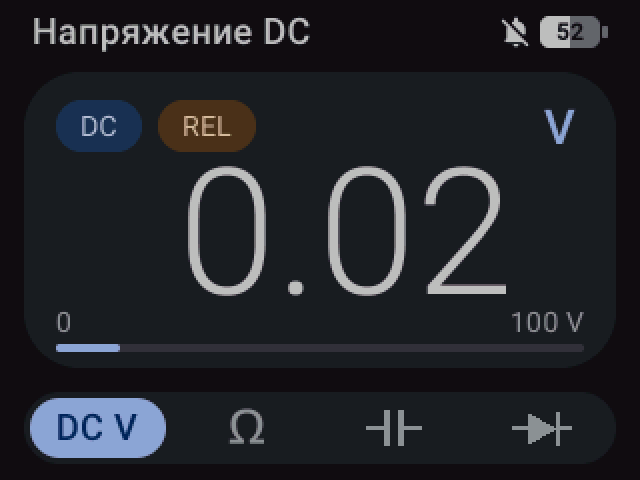
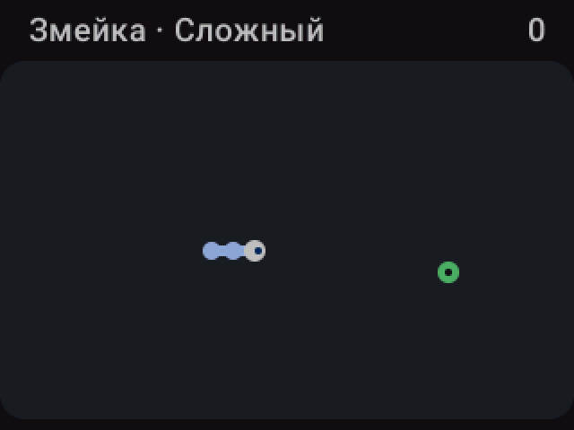
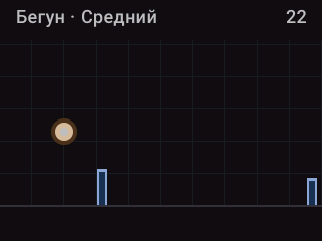
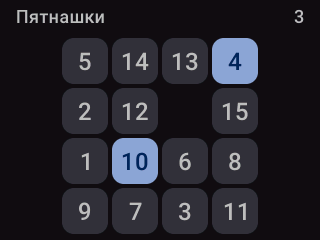

<div align="center">

# Кастомная прошивка DMT-99

[](README.md)

**Прошивка для мультиметра FNIRSI DMT-99, написанная с нуля на Rust:
интерфейс в стиле Material 3, симулятор для ПК и прошивальщик для Linux в один клик.**


&nbsp;

</div>

---

## Главное

- **Родной интерфейс без картинок.** Всё рисуется кодом: сглаженные скруглённые фигуры,
  цвета Material 3, иконки Google Material Symbols и батарейка как в Android.
- **Аккуратная типографика.** Глифы Roboto отрисованы с суперсэмплингом и хранятся в двух
  субпиксельных фазах, текст раскладывается с шагом 1/16 px и с кернингом шрифта, поэтому
  интервалы между буквами ровные даже на экране 320×240.
- **Быстро.** Загружается в разы быстрее стоковой прошивки: из флеша ничего не распаковывается.
  Пока анимируется полоска режимов, перерисовываются только изменившиеся полосы экрана.
- **Привычное управление.** Те же кнопки и группы режимов, плюс долгие нажатия для DC/AC и REL.
- **Тишина.** По желанию глушит писк измерительной микросхемы при включении и при каждой
  смене режима, а звуки NCV и прозвонки может заменить своими, с настраиваемой громкостью.
- **Полоса диапазона.** Тонкая полоска под показанием показывает, какая часть текущего
  диапазона занята, от 0 до его предела. Пока прибор меняет диапазон, на экране остаётся
  последнее значение.
- **Настройки сохраняются**: яркость, автовыключение, звуки, запоминание режима, °C/°F и
  язык (русский / английский) хранятся во флеше прибора.
- **Игры** в меню: *Змейка* и *Бегун* (бесконечный бег по экрану осциллографа) с тремя
  уровнями сложности и классические *Пятнашки*.
- **Симулятор один в один.** Код интерфейса общий, поэтому на ПК видно ровно то, что рисует
  прибор. Имитатор измерительной микросхемы говорит на настоящем протоколе.
- **Безопасно попробовать.** Загрузчик не трогается: стоковую прошивку всегда можно вернуть.

## Скриншоты

| Измерения | | |
|:-:|:-:|:-:|
|  |  |  |
| Сопротивление | Переменный ток, перегрузка | Бесконтактный поиск напряжения |
|  |  |  |
| Диалог подтверждения | О прошивке | Относительный режим REL |
|  |  |  |
| Змейка | Бегун | Пятнашки |

## Управление

| Кнопка | Короткое нажатие | Удержание (0,6 с) |
|---|---|---|
| **▶ Вправо** | V → Ω → ёмкость → прозвонка | DC ↔ AC напряжение |
| **◀ Влево** | mA ↔ A | DC ↔ AC ток |
| **▼ Вниз** | °C → Hz → NCV → Live | — |
| **▲ Вверх** | HOLD | REL (относительный ноль) |
| **● Центр** | AUTO | Настройки / назад |
| **Питание** | Выключение (с сохранением настроек) | — |

В меню ▲/▼ переходят между строками, ◀/▶ меняют значение, OK переключает или открывает пункт.
В играх стрелки срабатывают сразу при нажатии, OK — кнопка действия, удержание OK — выход из игры.

## Настройки

| Пункт | По умолчанию | |
|---|---|---|
| Яркость | 4 / 5 | ШИМ подсветки |
| Автовыключение | 15 мин | Выкл / 5 / 15 / 30 мин бездействия |
| Звук выключения | выкл | |
| Тихая смена | **вкл** | Глушит писк микросхемы при включении и смене режима |
| Свой звук NCV | выкл | Прошивка пищит по уровню поля вместо микросхемы |
| Своя прозвонка | выкл | Свой тон при замыкании (добавляет ~170 мс задержки) |
| Помнить режим | вкл | Включаться в последнем режиме, а не в AUTO |
| Громкость | 3 / 4 | Для собственных звуков прошивки |
| Полоса диапазона | вкл | Полоска под показанием: какая часть диапазона занята |
| Температура | °C | °C / °F |
| Язык | Русский | Русский / English |
| Сброс настроек | | С диалогом подтверждения |
| Игры | | Змейка и Бегун (три уровня сложности), Пятнашки; рекорды по уровням хранятся до выключения |
| О прошивке | | Версия, автор, репозиторий |

## Быстрый старт (Linux)

```bash
./build.sh          # сборка → DMT99-custom.BIN
./flash-dmt99.sh    # запись в прибор, потом нажать AUTO на приборе
```

**Нет тулчейна?** Каждую версию с тегом собирает GitHub Actions: скачайте
`DMT99-custom-vX.Y.Z.BIN` на странице [Releases](../../releases) и прошейте его командой
`./flash-dmt99.sh DMT99-custom-vX.Y.Z.BIN`.

## Сборка

### 1. Установить инструменты (один раз)

В Debian / Ubuntu:

```bash
sudo apt install llvm python3 libsdl2-dev
curl --proto '=https' --tlsv1.2 -sSf https://sh.rustup.rs | sh    # пропустите, если rustup уже стоит
```

`llvm` даёт `llvm-objcopy`, `libsdl2-dev` нужен только для симулятора. Точная версия Rust и
цель RISC-V закреплены в `rust-toolchain.toml`; `./build.sh` ставит их при первом запуске,
поэтому локальная сборка байт в байт совпадает с релизами на GitHub.

### 2. Собрать

```bash
./build.sh
```

Скрипт проверяет инструменты и подсказывает, что доустановить, если чего-то не хватает.
Затем он компилирует прошивку, превращает её в `DMT99-custom.BIN` и проверяет, что образ
устроен так, как ждёт стоковый загрузчик.

## Прошивка из Linux

1. **Переведите прибор в режим обновления:** выключите его, зажмите **центральную
   (AUTO/MENU)** кнопку и кнопку **питания**, затем подключите USB.
2. **Запустите прошивальщик:**

   ```bash
   ./flash-dmt99.sh                 # прошивает DMT99-custom.BIN
   ./flash-dmt99.sh other.BIN       # или любой другой образ, например стоковую прошивку
   ```

   Он дождётся прибора, если тот ещё не подключён, спросит пароль sudo, сохранит резервную
   копию диска обновления в `backups/` и запишет файл.
3. **Нажмите AUTO на приборе**, когда скрипт попросит. Прибор установит прошивку примерно
   за 10 с и перезапустится.

**Иконка на рабочем столе (по желанию):** `./flash-dmt99.sh --install-launcher` добавляет
иконку *DMT-99 Flash* на рабочий стол и в меню приложений. Двойной щелчок прошивает прибор,
а `.BIN`-файл можно просто перетащить на иконку.

> **Зачем скрипт?** Загрузчик отдаёт том FAT12 с секторами по 4096 байт, но таблица разделов
> считает в 512-байтных единицах. Linux обрезает раздел и монтирует его только для чтения.
> `tools/bootdisk.py` читает диск напрямую, добавляет файл так же, как это сделала бы Windows
> (запись 8.3, непрерывные кластеры, обе FAT), записывает обратно только изменённые блоки и
> проверяет их повторным чтением.

**В Windows** скопируйте `.BIN` на диск `BOOT`, который появляется в режиме обновления, и
нажмите **AUTO**.

**Вернуть стоковую прошивку:** прошейте официальный `DMT-99_V2.4_20240306.BIN` от FNIRSI тем же
способом. Загрузчик и измерительная микросхема никогда не изменяются.

## Разработка

### Симулятор

```bash
cd sim && cargo run --release
```

Стрелки и Enter работают как кнопки, Shift + стрелка — долгое нажатие, Backspace — долгий OK.
`+` / `-` меняют заряд батареи, `C` включает зарядку, `Q` — выход.
Скриншоты без окна: `cargo run --release -- --shot out.ppm en,right,uplong`.

### Тесты

```bash
cd ui && cargo test
```

Тесты покрывают разбор протокола (на кадрах, снятых с настоящего прибора), переключение
режимов, хранение настроек, логику звука, раскладку текста и проверку, что каждая подпись
меню помещается рядом со своим переключателем на обоих языках.

### Шрифты и иконки

`ui/src/font_data.rs` генерируется и лежит в репозитории, так что это нужно только после
изменения глифов, размеров или иконок. Нужны Pillow (`sudo apt install python3-pil`),
пакеты `fonts-roboto-unhinted`, `fonts-noto-core`, `fonts-dejavu-core` и `fonts-font-awesome`
и шрифт Material Symbols:

```bash
curl -L --create-dirs -o tools/fonts/MaterialSymbolsRounded.ttf "https://github.com/google/material-design-icons/raw/master/variablefont/MaterialSymbolsRounded%5BFILL,GRAD,opsz,wght%5D.ttf"
python3 tools/gen_font.py > ui/src/font_data.rs
```

## Релизы

[Сценарий сборки](.github/workflows/build.yml) тестирует и собирает каждый push. Чтобы
выпустить версию, поднимите `version` в `ui/Cargo.toml` (прошивка показывает её в
*О прошивке*), закоммитьте и выполните:

```bash
git tag v1.3.0 && git push origin v1.3.0
```

Сценарий проверяет, что тег совпадает с версией, подписывает аттестацию происхождения сборки
(Sigstore) и прикладывает образ прошивки и его SHA-256 к новому релизу.

**Проверка релиза.** Аттестация доказывает, что файл собран сценарием этого репозитория из
коммита с тегом:

```bash
gh attestation verify DMT99-custom-v1.3.0.BIN -R vlw/fnirsi-dmt99-firmware
```

Сборка ещё и воспроизводимая (версия Rust закреплена), так что её можно проверить, вообще
не доверяя GitHub: `git checkout v1.3.0 && ./build.sh` даёт тот же SHA-256, что и файл
`.sha256` из релиза.

## Как это устроено

| Узел | Интерфейс |
|---|---|
| МК | WCH CH32V303RCT6, RISC-V, 144 МГц (HSE 8 МГц × 18) |
| Дисплей | 320×240, контроллер семейства ST7789, 16-битная шина 8080 на GPIOB, управление PC3–PC5/PC13 |
| Подсветка | TIM8 CH1, PC6 |
| Кнопки | PC8–PC12, кнопка питания PC2, удержание питания PC1 |
| Пищалка | TIM2 CH2, PA1 (общая с измерительной микросхемой) |
| Батарея | ADC1 канал 10 на PC0, признак зарядки на PA8 |
| Измерительная микросхема | USART1 9600 8N1 (PA9/PA10), приём через кольцевой буфер DMA |
| Настройки | Страница флеша `0x08040000`, запись стоковой последовательностью |

- **Измерения.** Измеряет, переключает диапазоны и калибрует отдельная измерительная
  микросхема. Прошивка выбирает режим командой `AA 55 05 <mode> 00 00 00 00 00 <mode+5>`.
  Микросхема отвечает событием, а затем шлёт 12-байтные кадры `5A A5 …` с содержимым своего
  ЖК: цифры, десятичная точка, единица и AC/DC. Прошивка повторяет команду, пока микросхема
  не подтвердит режим, потому что та может ещё загружаться.
- **Тихая смена.** Микросхема сама управляет общей пищалкой. Если держать PA1 в единице, пока
  микросхема собирается пищать, драйвер остаётся в насыщении и её тон не звучит. Прошивка
  отпускает линию через 250 мс после того, как микросхема подтвердит новый режим.
- **Отрисовка.** Экран рисуется полосами по 24 строки в буфер на 15 КБ: на целый кадр
  оперативной памяти нет. Каждая полоса сразу уходит на дисплей.
- **Размещение образа.** Приложение линкуется по адресу `0x6400` после стокового загрузчика
  на 25 КБ, с тем же заголовком и положением таблицы векторов, что и у стокового образа.

## Структура репозитория

```
ui/                   общий no_std-крейт: приложение, экраны, игры, виджеты Material 3, текст, разбор протокола
device/               прошивка: старт, драйверы на регистрах (тактирование, ЖК, кнопки, UART/DMA, флеш…)
sim/                  симулятор на SDL2 с имитатором измерительной микросхемы
tools/gen_font.py     растеризатор шрифтов и иконок (генерирует ui/src/font_data.rs)
tools/bootdisk.py     запись FAT12 на диск загрузчика (Linux)
build.sh              собирает DMT99-custom.BIN
flash-dmt99.sh        прошивальщик для Linux (--install-launcher добавляет иконку)
docs/screenshots/     картинки для README (ru/ — русский интерфейс)
```

## Ограничения

- В DMT-99 нет часов реального времени, поэтому нет ни времени, ни даты.
- Код режима прозвонки/диода (`0x0E`) выведен из стоковой прошивки, он не документирован.
- Точность измерений — это точность самой измерительной микросхемы: прошивка только
  показывает её результаты.

> **Безопасность.** Это любительский проект. Он не гарантирует точность, калибровку или
> категорию безопасности прибора. Не полагайтесь на него при опасных измерениях.

## Благодарности

- Исследование железа и протокола: [smhgzll/dmt-99-multimeter-custom-firmware](https://github.com/smhgzll/dmt-99-multimeter-custom-firmware)
  (MIT) — распиновка, инициализация ЖК и формат кадров измерительной микросхемы, здесь
  перепроверенные по стоковой прошивке.
- Шрифты и иконки: Roboto (Apache 2.0), Noto Sans и DejaVu Sans (OFL / свободные), Material
  Symbols (Apache 2.0), Font Awesome (OFL) для логотипа GitHub.
- FNIRSI и DMT-99 — товарные знаки их владельца. Проект не связан с FNIRSI и не содержит её
  прошивок.

## Лицензия

[MIT](LICENSE) © 2026 Vladimir Bely. Встроенные данные шрифтов сохраняют свои лицензии (см. Благодарности).

## Автор

**Vladimir Bely** · [github.com/vlw](https://github.com/vlw)
